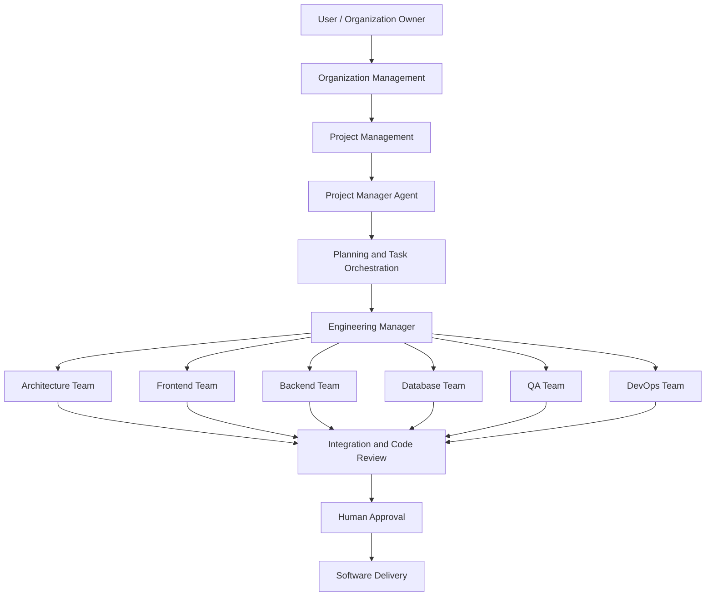

# AI-Native Software Engineering Organization

### Building an Autonomous AI-Powered Software Engineering Workforce

🚧 **Project Status: Actively Under Development**

## Overview

AI-Native Software Engineering Organization is an experimental platform designed to simulate a complete software engineering organization using specialized AI employees.

Instead of depending on a single AI coding assistant, the platform introduces a structured virtual organization where AI employees have dedicated engineering roles, responsibilities, teams, and collaborative workflows.

The long-term vision is to enable AI employees to work together across the software development lifecycle — from requirement analysis and architecture design to implementation, testing, and code review.

## Vision

Build a virtual software engineering company where multiple specialized AI employees collaborate like real engineering teams to plan, develop, test, and deliver software.

## Core Modules

### 1. Organization Management
- Create virtual software organizations.
- Define engineering departments.
- Organize AI employees into teams.
- Configure reporting structures and responsibilities.
- Manage organization-level settings.

### 2. AI Employee Management

The platform is designed to support specialized AI engineering roles.

| Department | Specialized AI Employees |
|---|---|
| Architecture | Software Architect, System Designer |
| Frontend Engineering | Frontend Developer, UI Engineer |
| Backend Engineering | Backend Developer, API Engineer |
| Database Engineering | Database Architect, Database Engineer |
| Quality Assurance | QA Engineer, Test Automation Engineer |
| DevOps | DevOps Engineer, Release Engineer |
| Security | Application Security Engineer |
| Code Quality | Code Reviewer, Refactoring Engineer |

### 3. Project Management
- Project creation and configuration.
- Requirement analysis.
- Task planning and decomposition.
- Task assignment.
- Dependency management.
- Project progress tracking.

### 4. Autonomous Engineering Workflows

The planned software development lifecycle includes:

1. Requirement understanding.
2. Project planning and task decomposition.
3. Architecture and technical design.
4. Task distribution among AI employees.
5. Code generation and modification.
6. Automated testing and debugging.
7. Code review and quality validation.
8. Human approval and delivery.

### 5. AI Team Collaboration
- Inter-agent communication.
- Shared project context.
- Task coordination.
- Execution tracking.
- Manager-level supervision.
- Human-in-the-loop approval.

### 6. Development Integrations

Planned integrations:
- GitHub repository management.
- Branch and pull request workflows.
- Automated testing.
- Code quality analysis.
- Development workflow automation.

## Architecture

The platform follows a modular architecture with organization management, agent orchestration, project management, and engineering execution as separate responsibilities.

## Technology Stack

| Layer | Technologies |
|---|---|
| Frontend | Next.js, React, TypeScript |
| Backend | Python, FastAPI, Pydantic |
| Database | PostgreSQL, pgvector |
| Background Jobs | Redis, ARQ |
| Object Storage | MinIO |
| Infrastructure | Docker Compose |
| AI Integration | LLM-powered agents |

## Development Roadmap

- [ ] Organization and department management
- [ ] AI employee creation and configuration
- [ ] Team and reporting structure
- [ ] Project management and task planning
- [ ] Agent orchestration and collaboration
- [ ] Software engineering execution workflows
- [ ] Code generation and modification
- [ ] Automated testing and debugging
- [ ] Code review and quality checks
- [ ] GitHub integration
- [ ] End-to-end software delivery

## Current Development Status

This project is actively being developed. Its architecture, organization structure, AI employee capabilities, and engineering workflows are being built incrementally.

The roadmap represents the intended capabilities, not a claim that every feature is currently available.

## Long-Term Goal

Create a complete AI-native software engineering organization where specialized AI employees collaborate across departments to build and deliver software under human supervision.

## Repository

[View on GitHub](https://github.com/gowthamdangeti/AI-Software-Engineering-Organization)
